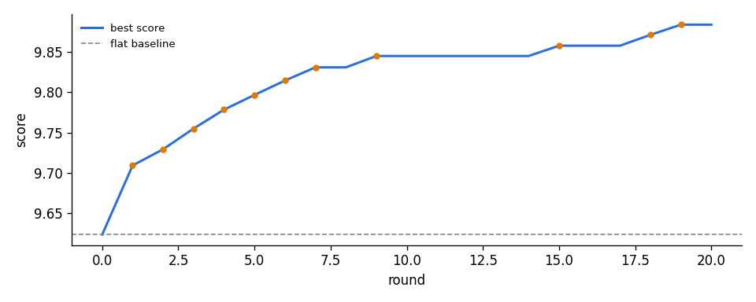
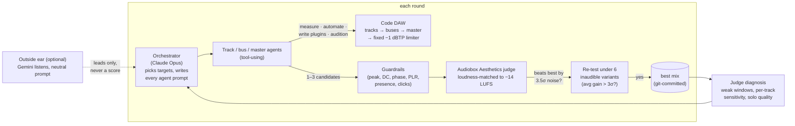

# Agentic Mix Loop

**A team of LLM agents mixes a song from raw multitracks inside a small, code-driven DAW. Every
change is kept or thrown away by a neural audio-quality judge, and only if it beats the judge's
own measured noise.**

The agents work like engineers at a console. They measure phrase levels, pitch and spectrum, write
volume rides and other automation, build buses and send reverbs, run a vocal tuner, and write
their own DSP plugins in Python behind a test harness. They can also audition drafts against the
judge before submitting. An orchestrator model plans each round and writes every agent's task
prompt. A hill-climbing loop then keeps only the changes that survive a statistical re-test.

<p align="center">
  
</p>

## Result: "Bankroll", 18 raw tracks, 20 rounds

The tracks went in exactly as delivered: no grouping, no DC removal, no prep.

| | score | PQ (production quality) | CE (content enjoyment) | worst 10 s window |
|---|---|---|---|---|
| flat sum of the raw tracks | 9.6237 | 8.299 | 7.501 | 7.821 |
| **agent mix** | **9.8836** | **8.474** | **7.752** | **8.132** |

**+0.26** on the composite score, about 21× the acceptance bar for a single change. The run made 11 accepted changes,
and every one passed the re-test. Total cost was **$6.22** in LLM calls over 42 minutes on one
RTX 3090. What the agents built, without being told to:

- a `LeadVox` group bus for five vocal tracks (+3 dB, rumble cut);
- a `VoxVerb` send bus: fully wet reverb with a filtered, automated return;
- the two FX vocals band-limited and pulled down 12 dB on their own bus;
- a custom plugin that centres the piano's low end, plus piano level rides in the four weakest
  sections;
- a gate and a 12 dB cut on a bleed-heavy sidestick;
- master EQ automation that dips the low-mids only in the windows the judge rated worst.

Full report with every accepted change and the final chains:
[`docs/results/bankroll_report.md`](docs/results/bankroll_report.md).

## How it works



### 1. A judge that can't be gamed by loudness or luck

- **Score** = 0.7 PQ + 0.3 CE + 0.2 × the worst 10-second window, from
  [Audiobox Aesthetics](https://github.com/facebookresearch/audiobox-aesthetics). The weights were
  chosen by a study on 6 songs: PQ-heavy weightings separate good mixes from broken ones best.
- **Loudness can't buy points.** Every candidate is gain-staged to −14 LUFS before a fixed
  true-peak limiter that no agent can touch.
- **Noise is measured, not assumed.** Phase 0 scores the same mix under inaudible changes
  (±1-sample shift, ±0.1 dB, ±0.1 dB on the loudest fader) to measure the judge's jitter σ.
- **Two-stage acceptance.** A candidate must first beat the best by 3.5σ. Then both it and the
  current best are re-scored under 6 inaudible variants, and the *averaged* gain must exceed 3σ.
  Averaging cuts the jitter about 2.5×, so small real gains get through and lucky ones don't.
- **The judge is the critic.** After each accept, the judge diagnoses the mix: which windows are
  weakest, how the score moves with each track at ±3 dB, and how each track scores solo. That
  diagnosis is the only critique the orchestrator plans from.

### 2. An agentic DAW instead of one-shot suggestions

Each target (a track, a bus or the master) gets a fresh tool-using agent with a 14-step budget.

| tool | what it gives the agent |
|---|---|
| `song_info`, `levels` | which tracks play when and how loud; phrase-by-phrase LUFS raw and in the mix |
| `pitch` | per-note pitch with cents and wobble, key candidates (Krumhansl) |
| `spectrum` | octave-band balance and the track's share of the mix per band |
| `judge_view` | the judge's diagnosis for this target |
| `plugin_source` / `write_plugin` | read a stock plugin; write a new one (runs the harness) |
| `audition` | render a draft into the full mix and score it (4 per round) |
| `submit` | 1–3 final candidates |

- **Session format.** A session is JSON: tracks → buses (group or send) → master. Any parameter
  can be automated (`{"auto": [[t, v], ...], "curve": "linear" | "step"}`). Gain and pan are
  automated per sample. Other parameters use crossfaded snapshot renders.
- **Stock plugins** (`core/stock/`): EQ, compressor, de-esser, saturation, clipper, gate, reverb,
  delay, gain/pan/width, and a **pitch corrector** (YIN detection + TD-PSOLA). The tuner is
  bit-exact on in-tune notes and lands within 0.5 cents of target.
- **Agent-written plugins** must pass `core/harness.py` before they're used:
  - a static check: allowed imports only, banned names, no dunder access;
  - signal tests in an isolated subprocess: shape, NaN, silence in → silence out, gain limits,
    latency and speed;
  - type-specific checks: an EQ must stay linear, a saturator must not alias, a tuner must fix a
    40-cent-sharp note without touching an in-tune one, a gate must never boost.

### 3. Guardrails before any score

Every candidate is checked before it's scored, against these limits:
- true peak ≤ −1 dBTP;
- no NaN, Inf or silence;
- exact length;
- DC offset;
- stereo and low-band (< 150 Hz) correlation;
- PLR ≥ 8 dB;
- every track and every bus within 18 dB of its original level relative to the mix;
- no new clicks.

Correlation, PLR, DC and clicks fall back to the flat baseline when the raw tracks already break
the absolute limit.

### 4. Outside ear (experimental)

Optionally, every 10 rounds, or when the loop stalls, a second model (Gemini) listens to the
current best mix. It hears the mix twice, with a neutral prompt ("Is there anything wrong with
the mix?"), no reference, and nothing about what changed.

- Only *mix* problems heard in **both** listens are kept.
- Each kept problem gets measurements for its time range attached: section loudness, the tracks
  that moved most, band balance.
- The orchestrator receives them as leads on *where to look*. They never score, veto or accept
  anything.

Turn it on with `[audit] enabled = true`. See [`core/outside_ear.py`](core/outside_ear.py).

## What I learned (the honest part)

- **LLM listeners are poor judges, but sometimes useful ears.** Gemini Flash failed every
  known-answer control in A/B tests:
  - it reported differences between two *identical* files;
  - it missed a crushed mix;
  - it preferred a harsh one.

  That's why the loop uses a neural judge for the reward, not an LLM.
- **Gemini 4 Argon is a better ear.** Asked neutrally about the final Bankroll mix, Argon flagged
  the same section in two independent listens: "second rap verse too loud, on top of the beat".
  Measurement confirmed it: that section's vocal had been lifted 2.8 dB, more than any other
  section. The judge never pointed there.
  - Argon is still unreliable on tone and dynamics. It never named over-compression in a crushed
    mix, and caught a +10 dB harsh top end in only one of two listens
    ([controls](docs/results/alright_argon_controls.json)).
- **Audiobox is blind to brightness.** No weighting of its four axes reliably penalises a +10 dB
  shelf at 5 kHz.
  - Its PC axis (production complexity) *rewards* over-compression on every song tested, so it
    is never part of the score.
  - Both findings come from `python mixloop.py axes`
    ([data](docs/results/axes_study.json)).
- **Raw tracks need automation, not faders.** An earlier Bankroll run on pre-grouped stems got
  stuck: phrases recorded at very different levels meant any fader move fixed one section and
  broke another. Giving agents the raw tracks plus volume automation doubled the gain
  (+0.13 → +0.26).
- **Judge jitter is the enemy of hill-climbing.** With a single fixed margin you must choose
  between letting lucky noise through and blocking small real gains. The averaged re-test lets the
  first bar sit lower, because a lucky draw rarely survives six re-scorings. On Bankroll all 11
  changes that cleared the first bar also held up under the re-test.

## Quickstart

Needs Python 3.12 and an NVIDIA GPU (the judge runs about 1 s per 3.5-minute song on an RTX 3090),
plus an [OpenRouter](https://openrouter.ai) key. All LLM calls go through OpenRouter.

```bash
python -m venv .venv
.venv/Scripts/activate            # Windows  (source .venv/bin/activate on Linux/macOS)
pip install torch torchaudio --index-url https://download.pytorch.org/whl/cu124
pip install -r requirements.txt
export OPENROUTER_API_KEY=sk-or-...   # PowerShell: $env:OPENROUTER_API_KEY = "sk-or-..."
```

```bash
# 1. Import a multitrack (zip or folder). --raw copies every track exactly as delivered.
python mixloop.py import path/to/multitrack.zip --name mysong --raw

# 2. Phase 0: measure judge noise and check it can tell good mixes from broken ones.
python mixloop.py phase0 mysong

# 3. Mix. Resumes from state.json; --fresh starts over; Ctrl-C stops cleanly and writes the report.
python mixloop.py run mysong --no-listen

# Offline smoke test: no API key, random-search agents.
python mixloop.py run mysong --agent random --max-rounds 5
```

Output lands in `songs/mysong/`:
- `report.md`;
- `renders/final/`: the flat sum, the best mix, a loud master and a score chart;
- `chains/final.json`: the exact session, rebuildable with
  `mixloop.py score mysong --chain chains/final.json`.

Each song folder is its own git repo, with one commit per accepted change.

### All commands

| command | what it does |
|---|---|
| `import <zip\|dir> --name S [--raw \| --groups auto\|none\|file.json]` | bring in a multitrack |
| `phase0 S [S ...] [--gemini] [--human]` | judge noise + known-answer checks |
| `run S [--phase 2..5] [--agent llm\|random] [--max-rounds N] [--max-usd X] [--fresh] [--no-listen]` | the loop |
| `score S [--chain file.json] [--out mix.wav] [--windows]` | render + guardrails + score one session |
| `diagnose S` | the judge's critique of the current best (no API key needed) |
| `harness plugin.py` | run the plugin test harness on any file |
| `cards S [--force]` | Gemini description cards per track (factual, no opinions) |
| `listen S` | blind A/B of the current best vs your last liked checkpoint (rollback after 2 "old" votes) |
| `audit S [--repeats N]` | Gemini A/B on the final mix with known-answer controls |
| `axes [S ...]` | compare judge-axis weightings on stored Phase 0 data |
| `report S` | regenerate the report |

### Configuration

Everything is in [`config.toml`](config.toml). A song can override any key in
`songs/<song>/config.toml`.

| section | sets |
|---|---|
| `[models]` | which model plays which role |
| `[score]` | weights, re-test sigmas |
| `[guardrails]` | the limits above |
| `[limits]` | plugins per type per chain |
| `[loop]` | rounds, budget, agent step and audition limits |
| `[audit]` | the outside ear |

| role | default model |
|---|---|
| orchestrator, master-bus agent | `anthropic/claude-opus-5.5` |
| track and bus agents | `openai/gpt-6.1-sol` |
| description cards | `google/gemini-3.8-flash` |
| outside ear | `google/gemini-4-argon` |

## Repository layout

```
mixloop.py            CLI
config.toml           defaults
core/
  orchestrator.py     the loop: plan → propose → guardrails → score → re-test → accept
  daw_agent.py        tool-using agents (OpenRouter function calling)
  tools.py            measurement tools: levels, pitch, spectrum, judge view
  render.py           session renderer: automation, buses, sends, fixed limiter
  plugins.py          session format, validation, plugin store, descriptions
  stock/              stock plugins incl. the pitch corrector
  harness.py          static + signal tests for agent-written plugins
  judge.py            Audiobox scoring (windows, weights); judge_worker.py restartable GPU worker
  evaluate.py         loudness matching, noise measurement, re-test variants, score cache
  guardrails.py       hard technical limits
  diagnose.py         the judge as critic
  outside_ear.py      optional second-model listen (leads only)
  gemini.py, audit.py description cards, A/B and open-listen audits
  awmeter.py          Airwindows Meter port (numba), meter_study.py
  phase0.py, axes.py  judge validation studies
tests/                harness, loop logic, DAW agent (fake LLM), LLM paths, judge worker
docs/results/         reports and study data from the runs above
```

## Tests

```bash
python tests/test_harness.py     # stock plugins pass, six bad fixture plugins are rejected
python tests/test_loop.py        # accept / rollback / hold-out logic on a dummy judge
python tests/test_daw.py         # raw import, every tool, automation, buses, plugin writing (fake LLM)
python tests/test_llm_paths.py   # orchestrator + one-shot agents against a fake LLM
python tests/test_judge_worker.py  # needs the GPU judge
```

## Limitations

- **One judge.** The mix is only as good as Audiobox's taste, and it's blind to harshness.
  The optional blind listening check (`listen`) puts a human in the loop.
- **The harness isn't a sandbox.** It stops accidents and lazy shortcuts, not a determined
  attacker. Approved plugins run in the main process.
- **Windows GPU timeouts.** On Windows, keep `[score] batch_size` small (default 4). Driver
  timeouts (TDR) can kill long GPU kernels.
- **No audio here.** Multitracks aren't included. The songs tested are free multitracks from the
  [Cambridge-MT](https://cambridge-mt.com/ms/mtk/) library, which allows practice use but not
  redistribution.

## Credits

- [Audiobox Aesthetics](https://github.com/facebookresearch/audiobox-aesthetics) (Meta): the judge.
- [Airwindows Meter](https://github.com/airwindows/Meter) by Chris Johnson (MIT), ported in
  `core/awmeter.py`. See [THIRD_PARTY_NOTICES.md](THIRD_PARTY_NOTICES.md).
- [Pedalboard](https://github.com/spotify/pedalboard) (Spotify) and
  [pyloudnorm](https://github.com/csteinmetz1/pyloudnorm) for DSP building blocks and loudness.

## License

MIT. See [LICENSE](LICENSE).
