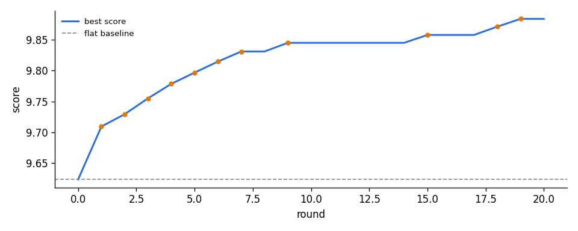

# Mix report: bankroll

Stopped: round cap 20  
Rounds: 20, accepted changes: 11, LLM spend: $6.22, wall-clock 41.8 min  
Phase 5, agent llm, acceptance margin 0.0123 (judge noise spread 0.0127)

## Scores

| | score | PQ | CE | worst window | PC | CU |
|---|---|---|---|---|---|---|
| flat baseline | 9.6237 | 8.299 | 7.501 | 7.821 @ 40s | 6.593 | 7.783 |
| best mix | 9.8836 | 8.474 | 7.752 | 8.132 @ 115s | 6.612 | 7.965 |

Change vs baseline: **+0.2599**

## Files

- `renders/final/1_flat_baseline.wav` (flat sum through the fixed limiter)
- `renders/final/2_best_mix.wav` (best mix at -14.0 LUFS)
- `renders/final/3_best_mix_loud.wav` (final limiter pushed to -9.5 LUFS, -1.05 dBTP)
- `chains/final.json` (rebuild exactly with `python mixloop.py score bankroll --chain chains/final.json`)

## Accepted changes

- round 1 `*balance*` +0.0856 -> 9.7093: Follow measured sensitivities: piano up, drums (kick/snare/sidestick/hihat) down, Vox3 and VoxFX2 down, Clap1 and Vox4 slightly up. Kick folded to mono, piano kept wide.
- round 2 `11_Vox3` +0.0200 -> 9.7293: Strongest measured result: 7 dB additional reduction (+0.0200 score); retain natural tone and left placement while reducing vocal competition.
- round 3 `08_Piano` +0.0256 -> 9.7549: Best audition: +0.0256, clears first-pass margin; robustness retest still required. Piano +5 dB with 300 Hz buildup reduced and broad 2 kHz presence, bass centered and 65 Hz high-pass. Other tested variants reduced score.
- round 4 `03_Sidestick` +0.0235 -> 9.7784: C — Untested cleanup alternative: same cut and 180 Hz high-pass plus gentle downward expansion to reduce between-hit bleed, with fast opening and 80 ms release.
- round 5 `master` +0.0182 -> 9.7965: Mud dip automated across all three weak windows, +1.5 air, glue comp (+0.0182)
- round 6 `bus:VoxFX` +0.0178 -> 9.8144: B — Same -12 dB cut with 220 Hz HP / 7.5 kHz LP cleanup; tested +0.0178, only marginally above plain attenuation.
- round 7 `bus:LeadVox` +0.0164 -> 9.8307: Best measured result: +0.0164 versus the +0.0123 first-bar margin. Uniform +3 dB group lift and 95 Hz rumble cut; dry, with no piano changes. EQ/compression, stronger gain, and weak-window rides all scored lower.
- round 9 `bus:VoxVerb` +0.0141 -> 9.8448: Best measured result: +0.0141, PQ +0.0096 and CE +0.0156; passes first bar, pending robustness re-test. Fully wet diffuse reverb, filtered return and reduced rap ambience.
- round 15 `master` +0.0128 -> 9.8575: Pushed tonal rebalance: broad mud cut -3.5 (-5/-4.5 in weak windows), low shelf +1.5@100, presence +2@2.5k, air +1.5, glue comp (auditioned +0.0128, passes first bar)
- round 18 `04_Clap1` +0.0134 -> 9.8709: Best audition: +0.0134 versus required +0.0123; passed initial bar and guardrails. Darker, quieter clap with smooth extra cuts in the weakest windows; pending robustness re-test.
- round 19 `08_Piano` +0.0126 -> 9.8836: Best tested refinement: +0.0126, narrowly clears +0.0123 first-pass margin; guardrails passed, robustness not yet confirmed. +2 dB rides in all four weak regions, stronger 2 kHz presence, gentle 7 kHz shelf and width 1.4; original bass centering and low-mid cut retained.

## Hold-out flags

- round 10: PC fell -0.044 while PQ+CE rose +0.354

## Final chains

- **01_Kick**: gain_pan(gain_db=-2.5, pan=0, width=0)
- **02_Snare**: gain_pan(gain_db=-2, pan=0, width=0.6)
- **03_Sidestick**: eq(hp_hz=180, low_shelf_hz=120, low_shelf_db=0, peak1_hz=300, peak1_db=0, peak1_q=1, peak2_hz=3000, peak2_db=0, peak2_q=1, high_shelf_hz=8000, high_shelf_db=0, lp_hz=20000) -> gate(threshold_db=-42, ratio=2, attack_ms=0.1, release_ms=80) -> gain_pan(gain_db=-12, pan=0, width=0.6)
- **04_Clap1**: eq(hp_hz=200, low_shelf_hz=120, low_shelf_db=0, peak1_hz=300, peak1_db=0, peak1_q=1, peak2_hz=2400, peak2_db=-4.5, peak2_q=0.7, high_shelf_hz=7000, high_shelf_db=-2.5, lp_hz=20000) -> gain_pan(gain_db=auto[linear 0s:-12>39.7s:-12>40s:-14>50s:-14>50.3s:-12>114.7s:-12>115s:-14>130s:-14>...], pan=0, width=0.6)
- **05_Clap2**: gain_pan(gain_db=0, pan=0, width=1)
- **06_HiHat**: gain_pan(gain_db=-2.5, pan=0, width=1)
- **07_HiHat**: gain_pan(gain_db=-1, pan=20, width=1)
- **08_Piano**: plugins/08_Piano/001_eq_piano_bass_center.py(crossover_hz=250, amount=1) -> eq(hp_hz=65, low_shelf_hz=120, low_shelf_db=0, peak1_hz=300, peak1_db=-3, peak1_q=0.85, peak2_hz=2000, peak2_db=6, peak2_q=0.6, high_shelf_hz=7000, high_shelf_db=1.5, lp_hz=20000) -> gain_pan(gain_db=auto[linear 0s:8.5>39.6s:8.5>40s:10.5>50s:10.5>50.4s:8.5>81.6s:8.5>82s:10.5>90s:10.5>...], pan=0, width=1.4)
- **09_Vox1**: gain_pan(gain_db=0.5, pan=0, width=1)
- **10_Vox2**: gain_pan(gain_db=0, pan=0, width=1)
- **11_Vox3**: gain_pan(gain_db=-10, pan=-15, width=1)
- **12_Vox4**: gain_pan(gain_db=1.5, pan=10, width=1)
- **13_Vox5**: gain_pan(gain_db=0.5, pan=0, width=1)
- **14_Vox6**: gain_pan(gain_db=1, pan=0, width=1)
- **15_Vox7**: gain_pan(gain_db=1, pan=0, width=1)
- **16_Vox8**: gain_pan(gain_db=0, pan=0, width=1)
- **17_VoxFX1**: gain_pan(gain_db=-1.5, pan=0, width=1)
- **18_VoxFX2**: gain_pan(gain_db=-2.5, pan=0, width=1)
- **bus VoxFX: inputs [17_VoxFX1, 18_VoxFX2] sends [-] chain eq(hp_hz=220, low_shelf_hz=120, low_shelf_db=0, peak1_hz=300, peak1_db=0, peak1_q=1, peak2_hz=3000, peak2_db=0, peak2_q=1, high_shelf_hz=8000, high_shelf_db=0, lp_hz=7500) -> gain_pan(gain_db=-12, pan=0, width=1)**
- **bus LeadVox: inputs [10_Vox2, 12_Vox4, 13_Vox5, 14_Vox6, 15_Vox7] sends [-] chain eq(hp_hz=95, low_shelf_hz=120, low_shelf_db=0, peak1_hz=300, peak1_db=0, peak1_q=1, peak2_hz=3000, peak2_db=0, peak2_q=1, high_shelf_hz=8000, high_shelf_db=0, lp_hz=20000) -> gain_pan(gain_db=3, pan=0, width=1)**
- **bus VoxVerb: inputs [-] sends [08_Piano@-22dB, 10_Vox2@-16dB, 11_Vox3@-18dB, 12_Vox4@-18dB, 13_Vox5@-18dB, 14_Vox6@-20dB, 15_Vox7@-20dB] chain reverb(room_size=0.55, damping=0.7, width=1, predelay_ms=38, lowcut_hz=300, highcut_hz=6500, mix=1) -> eq(hp_hz=300, low_shelf_hz=120, low_shelf_db=0, peak1_hz=300, peak1_db=0, peak1_q=1, peak2_hz=3000, peak2_db=0, peak2_q=1, high_shelf_hz=8000, high_shelf_db=0, lp_hz=6500) -> gain_pan(gain_db=auto[linear 0s:-8>8s:-4>30s:-4>32s:-8>45s:-6>48s:-4>67s:-4>69s:-12>...], pan=0, width=1)**
- **master**: eq(hp_hz=30, low_shelf_hz=100, low_shelf_db=1.5, peak1_hz=350, peak1_db=auto[step 0s:-3.5>29.5s:-3.5>30s:-5>50s:-5>50.5s:-3.5>111.5s:-3.5>112s:-4.5>126s:-4.5>...], peak1_q=0.6, peak2_hz=2500, peak2_db=2, peak2_q=0.7, high_shelf_hz=10000, high_shelf_db=1.5, lp_hz=20000) -> comp(threshold_db=-16, ratio=1.7, attack_ms=25, release_ms=150, makeup_db=0, mix=1) -> fixed limiter -1.0 dBTP
