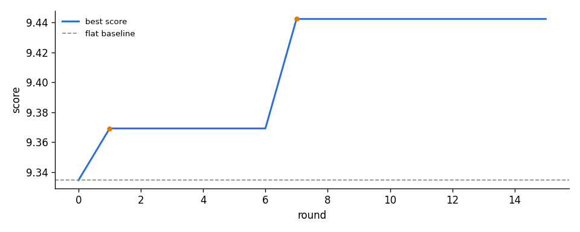

# Mix report: teleport

Stopped: plateau: 8 rounds without an accepted change  
Rounds: 15, accepted changes: 2, LLM spend: $2.81, wall-clock 16.8 min  
Phase 5, agent llm, acceptance margin 0.0284 (judge noise spread 0.0142)

## Scores

| | score | PQ | CE | worst window | PC | CU |
|---|---|---|---|---|---|---|
| flat baseline | 9.3346 | 8.185 | 7.162 | 7.283 @ 5s | 6.452 | 7.778 |
| best mix | 9.4423 | 8.231 | 7.197 | 7.607 @ 0s | 6.465 | 7.821 |

Change vs baseline: **+0.1077**

## Files

- `renders/final/1_flat_baseline.wav` (flat sum through the fixed limiter)
- `renders/final/2_best_mix.wav` (best mix at -14.0 LUFS)
- `renders/final/3_best_mix_loud.wav` (final limiter pushed to -9.8 LUFS, -1.05 dBTP)
- `chains/final.json` (rebuild exactly with `python mixloop.py score teleport --chain chains/final.json`)

## Accepted changes

- round 1 `*balance*` +0.0346 -> 9.3691: Follow the strongest measured hints: beat down 3 dB and LeadVox1 up 3 dB, which also covers the weak intro window. LeadVox2 and BackingVox4 up slightly. Backing vox stay near neutral, with mild panning for space. All mono vocals keep the leads centered.
- round 7 `02_LeadVox1` +0.0731 -> 9.4423: B: stronger outtake removal using the same foundation and timing, capped at 24 dB rather than 30 dB to respect the custom-plugin gain-change limit.

## Final chains

- **01_Beat**: gain_pan(gain_db=-3, pan=0, width=1)
- **02_LeadVox1**: eq(hp_hz=80, low_shelf_hz=120, low_shelf_db=0, peak1_hz=320, peak1_db=-2, peak1_q=0.85, peak2_hz=3000, peak2_db=0, peak2_q=1, high_shelf_hz=8000, high_shelf_db=0, lp_hz=20000) -> comp(threshold_db=-18, ratio=2, attack_ms=20, release_ms=120, makeup_db=1.3, mix=1) -> plugins/02_LeadVox1/002_comp_timed_outtake_ducker.py(start_s=11.5, end_s=15.8, ramp_ms=100, reduction_db=24, intro_reduction_db=0) -> gain_pan(gain_db=1.5, pan=0, width=1)
- **03_LeadVox2**: gain_pan(gain_db=2, pan=0, width=1)
- **04_BackingVox1**: gain_pan(gain_db=1, pan=-20, width=1)
- **05_BackingVox2**: gain_pan(gain_db=0, pan=25, width=1)
- **06_BackingVox3**: gain_pan(gain_db=-1, pan=-25, width=1)
- **07_BackingVox4**: gain_pan(gain_db=1.5, pan=20, width=1)
- **master**: (empty) -> fixed limiter -1.0 dBTP
